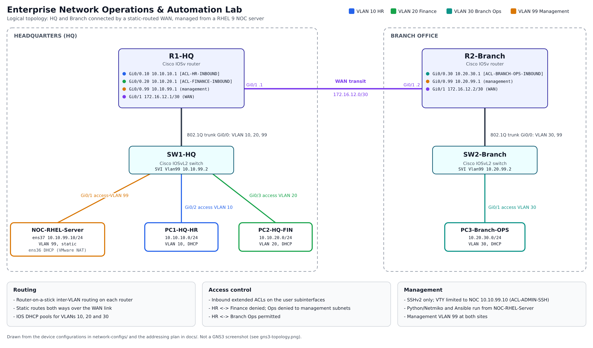
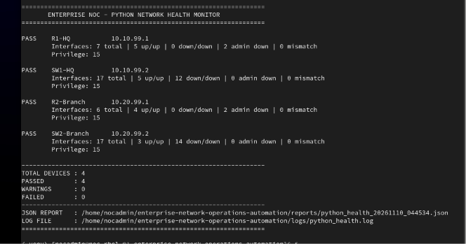
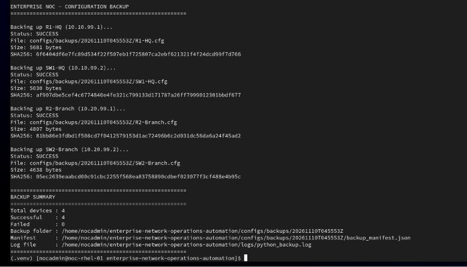
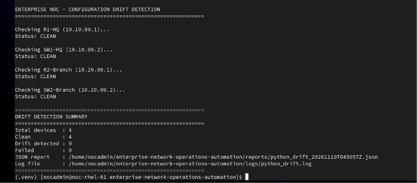
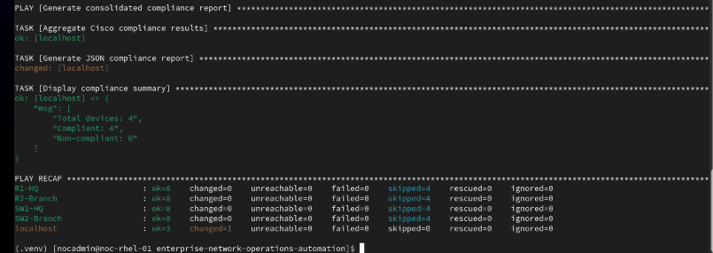
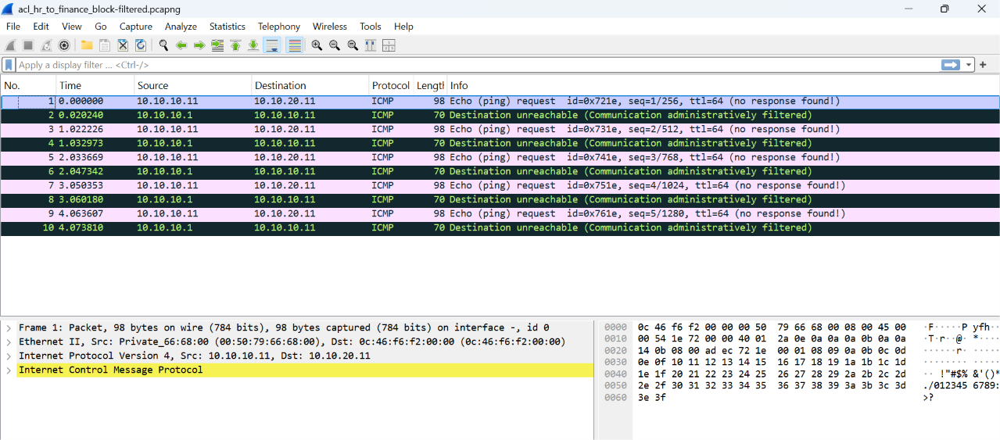

# Enterprise Network Operations & Automation Lab

A segmented HQ + Branch network on Cisco IOS, administered from a RHEL 9 NOC server with Python/Netmiko and Ansible. It covers VLAN segmentation, ACL-based access control, SSH-only management, configuration backup and drift detection, a read-only compliance audit, and packet-level verification of the access policies.

## Table of Contents

1. [Business scenario](#business-scenario)
2. [Topology](#topology)
3. [What this project demonstrates](#what-this-project-demonstrates)
4. [Results](#results)
5. [Evidence](#evidence)
6. [Design at a glance](#design-at-a-glance)
7. [Automation](#automation)
8. [Packet analysis](#packet-analysis)
9. [Quick start](#quick-start)
10. [Repository structure](#repository-structure)
11. [Technology stack](#technology-stack)
12. [Author and license](#author-and-license)

## Business scenario

A fictional company runs a head office (HQ) and one branch office. HR and Finance staff work at HQ, an operations team works at the branch, and a small Network Operations Center (NOC) looks after the network. The NOC needs to:

| Business need | How the lab addresses it | Status |
|---|---|---|
| Keep departments apart (BR-01) | Departmental VLANs, inter-VLAN routing and extended ACLs | Validated |
| Control who can administer devices (BR-02) | SSHv2 only, with VTY access limited to the NOC host | Validated |
| Stop repeating manual checks (BR-03) | Python health check, drift detection and an Ansible compliance audit | Validated |
| Keep reliable, verifiable backups (BR-04) | Timestamped backups with SHA-256 manifests and restricted file permissions | Validated |
| Prove that access rules work (BR-05) | Connectivity tests, ACL counters and Wireshark captures | Validated |
| Restrict unauthorized devices on access ports (BR-06) | Port security with sticky MAC binding in restrict mode on the access ports | Validated |

The scenario is simulated for this lab and involves no real organization. The full requirement-to-evidence mapping is in [`docs/01-business-requirements.md`](docs/01-business-requirements.md).

## Topology



The diagram is drawn from the device configurations in [`network-configs/`](network-configs/). The original GNS3 view is in [`topology/gns3-topology.png`](topology/gns3-topology.png), and the cabling table is in [`topology/device-connections.md`](topology/device-connections.md).

The GNS3 project file is included as a reference copy: [`topology/enterprise-noc-automation-lab.gns3`](topology/enterprise-noc-automation-lab.gns3). It needs your own licensed Cisco IOSv and IOSvL2 images and a RHEL 9 VM, none of which are included (the VM path inside it is from the author's PC), and the VM appears in GNS3 as `NOC-RHEL-Server-1`. Its links match the cabling table.

## What this project demonstrates

| Skill | What was built | Where to look |
|---|---|---|
| Network design | Two sites, router-on-a-stick inter-VLAN routing, 802.1Q trunks, static routing over a /30 WAN | [`docs/02-network-architecture.md`](docs/02-network-architecture.md), [`network-configs/`](network-configs/) |
| Network security | Inbound extended ACLs per VLAN, port security on access ports, SSHv2 only, VTY access limited to the NOC host | [`network-configs/`](network-configs/), [`testing/validation-matrix.md`](testing/validation-matrix.md) |
| Python automation | Netmiko health check, configuration backup with SHA-256 manifest, baseline drift detection with unified diffs | [`automation/python/`](automation/python/README.md) |
| Ansible | Read-only compliance audit: 16 checks across 4 devices, driven by a policy variables file | [`automation/ansible/`](automation/ansible/README.md) |
| Linux administration | RHEL 9 NOC server: NetworkManager with two NICs, SSH, users and permissions, Python virtual environment | [`linux/`](linux/README.md) |
| Packet analysis | Seven filtered Wireshark/TShark captures showing permitted and denied flows and an SSH session | [`packet-analysis/`](packet-analysis/README.md) |
| Testing and traceability | Validation matrix, unit tests, and business requirements mapped to evidence | [`testing/`](testing/validation-matrix.md), [`docs/01-business-requirements.md`](docs/01-business-requirements.md) |

## Results

These are the results recorded during lab testing, not a production deployment.

| Check | Result | Evidence |
|---|---|---|
| Python health check | 4/4 devices passed | [Validation matrix §5](testing/validation-matrix.md) |
| Configuration backups | 4/4 successful, 4 checksums verified | [Validation matrix §5](testing/validation-matrix.md) |
| Drift detection against baselines | 4/4 CLEAN | [Validation matrix §5](testing/validation-matrix.md) |
| Ansible compliance audit | 16/16 checks, 4/4 devices compliant | [Ansible audit](automation/ansible/README.md) |
| Unit tests | 10 passed | [`automation/python/tests/`](automation/python/tests/) |
| ACL policy tests | HR to Finance, Finance to HR, Ops to both management subnets denied (ICMP type 3, code 13); HR and Branch Ops permitted | [Validation matrix §3](testing/validation-matrix.md), [captures](packet-analysis/README.md) |
| Port security | Unknown device on SW1 Gi0/2 got no DHCP lease or connectivity; violation counter and log recorded its MAC; port stayed up | [Validation matrix §10](testing/validation-matrix.md) |
| WAN and SSH | R1-HQ to R2-Branch ICMP; RHEL to R1-HQ SSH with privilege level 15 | [Validation matrix §2 and §4](testing/validation-matrix.md) |

## Evidence

Terminal output from the RHEL 9 NOC server and from the packet captures in this repository.

**Health check: 4 of 4 devices passed, privilege level 15**



**Configuration backup: 4 of 4 successful, with a SHA-256 checksum per file**



**Drift detection: 4 of 4 devices CLEAN against the approved baselines**



**Ansible compliance audit: 4 compliant devices, nothing failed or unreachable**



**HR to Finance blocked by the ACL.** Each echo request is answered by the gateway, 10.10.10.1, with ICMP type 3, code 13. Wireshark labels this "administratively filtered". The capture is [`acl_hr_to_finance_block-filtered.pcapng`](packet-analysis/captures/acl_hr_to_finance_block-filtered.pcapng).



## Design at a glance

| Site | VLAN | Purpose | Network | Gateway |
|---|---:|---|---|---|
| HQ | 10 | HR | 10.10.10.0/24 | 10.10.10.1 |
| HQ | 20 | Finance | 10.10.20.0/24 | 10.10.20.1 |
| HQ | 99 | Management | 10.10.99.0/24 | 10.10.99.1 |
| Branch | 30 | Operations | 10.20.30.0/24 | 10.20.30.1 |
| Branch | 99 | Management | 10.20.99.0/24 | 10.20.99.1 |
| WAN | n/a | Transit | 172.16.12.0/30 | R1-HQ .1, R2-Branch .2 |

Design decisions:

- **Static routing instead of OSPF.** Two routers with one path between them gain nothing from a routing protocol. The reasoning is in [`docs/02-network-architecture.md`](docs/02-network-architecture.md).
- **Router-on-a-stick.** One trunk per site keeps the lab small. Each user VLAN has its own subinterface.
- **Dedicated management VLAN 99 at each site.** Device management is separated from user traffic. The NOC host sits in HQ VLAN 99.
- **ACLs on the user subinterfaces, inbound.** Traffic is filtered where it enters the router. A standard ACL (`ACL-ADMIN-SSH`) limits VTY access to the NOC host `10.10.99.10`.

Full tables: [IP addressing plan](docs/03-ip-addressing-plan.md).

## Automation

All tools run from the RHEL 9 NOC server and read credentials from environment variables (`.env`, never committed).

| Tool | What it does | Output |
|---|---|---|
| `health_check.py` | Connects over SSH, checks privilege level, collects interface status and classifies it | JSON report, log |
| `config_backup.py` | Collects running configs, verifies hostname and privilege, writes timestamped backups with a SHA-256 manifest | Backups, manifest, log |
| `config_drift.py` | Verifies baseline checksums, compares live configs against the baseline, writes unified diffs | Diffs, JSON report |
| `compliance_audit.yml` (Ansible) | Read-only checks of management ACLs, VTY settings, VLANs, trunks, interface ACLs and static routes | JSON report |

Details: [Python automation](automation/python/README.md) and [Ansible compliance audit](automation/ansible/README.md). Generated files are written with restricted permissions (600 for files, 700 for directories) and are excluded by `.gitignore`.

## Packet analysis

[`packet-analysis/captures/`](packet-analysis/captures/) holds seven filtered PCAPNG files: six ICMP captures (WAN transit, four denied flows, one permitted flow) and one SSH session from the NOC host to R1-HQ. The capture inventory, filtering method and interpretation notes are in [`packet-analysis/README.md`](packet-analysis/README.md).

## Quick start

Requirements: RHEL 9, Python 3.9, and reachability to the lab devices over the management network. The recorded results were produced with Ansible Core 2.15.13, Netmiko 4.6.0 and Paramiko 4.0.0.

Download the repository as a ZIP from GitHub, extract it, and run from the project root:

```bash
python3 -m venv .venv
source .venv/bin/activate
pip install -r requirements.txt
ansible-galaxy collection install -r automation/ansible/requirements.yml

cp .env.example .env
chmod 600 .env          # then edit .env with your lab credentials
```

Review `automation/ansible/inventory/hosts.yml` and make sure the devices' SSH host keys are trusted (host key checking is enabled).

```bash
# Python tools
PYTHONPATH=automation/python .venv/bin/python -m noc_automation.health_check
PYTHONPATH=automation/python .venv/bin/python -m noc_automation.config_backup
PYTHONPATH=automation/python .venv/bin/python -m noc_automation.config_drift

# Ansible compliance audit
bash automation/ansible/run-compliance

# Unit tests
PYTHONPATH=automation/python .venv/bin/python -m unittest discover -s automation/python/tests -v
```

Drift detection needs approved baseline configs in `configs/baselines/initial/` with a `baseline_manifest.json`. Baselines and backups are never published, so supply your own. Runtime output goes to `configs/backups/`, `configs/drift/`, `reports/` and `logs/`, all git-ignored.

## Repository structure

```text
enterprise-network-operations-automation/
├── README.md
├── LICENSE
├── requirements.txt
├── .env.example
├── .gitignore
├── docs/                      Requirements, architecture and addressing
│   ├── 01-business-requirements.md
│   ├── 02-network-architecture.md
│   └── 03-ip-addressing-plan.md
├── topology/                  Diagram, GNS3 view and project file, cabling table
├── network-configs/           Exact device configuration exports (drift baselines)
│   ├── routers/
│   └── switches/
├── linux/                     RHEL 9 NOC server documentation
├── automation/
│   ├── python/                noc_automation package, unit tests
│   └── ansible/               Inventory, playbook, policy vars, run-compliance
├── testing/                   Validation matrix
├── evidence/                  Screenshots of tool runs and the ACL denial
└── packet-analysis/           Capture notes and filtered PCAPNG files
```

## Technology stack

GNS3, VMware Workstation, Cisco IOSv 15.9(3)M8, Cisco IOSvL2 15.2, RHEL 9, Python 3, Netmiko, Paramiko, Ansible (`cisco.ios`), YAML, JSON, Wireshark, TShark.

## Author and license

Palukuru Harsha Vardan. Released under the [MIT License](LICENSE).
